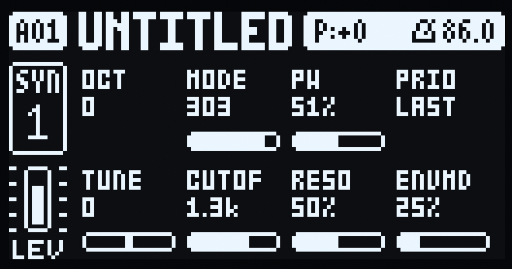
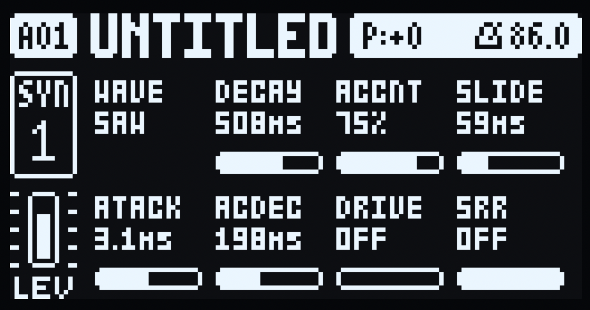

# PHREAKOID - an acid machine for the Digitone mk1

PHREAKOID is a monophonic acid machine: one band-limited saw/square
oscillator into the classic four-pole ladder filter with its feedback highpass,
a resonant exponential filter envelope, accent driven by note velocity, glide
and a fixed amp envelope - the squelchy, resonant character the FM engine
cannot make. It is an integer (fixed-point) port of the acid voice in Robin
Schmidt's **Open303** (MIT, <https://github.com/RobinSchmidt/Open303>), reduced
to work at the Digitone's own 48 kHz rate with table-driven coefficients. The
engine runs its own filter and amp envelopes, and plays through the Digitone's
multimode filter, mixer, effects, track level and velocity as FM does.

Pick it per track from **MACHINES** (hold a track key). A sound's machine is
its sound slot 0, so sound locks switch engines per trig, and p-locks, LFOs,
MIDI CC and presets work on its knobs as on FM. Every knob is a borrowed stock
parameter so a PHREAKOID sound saves, syncs and reloads like any other, and
switching the machine back to FM leaves valid FM settings.

Requires a **Digitone mk1** or **Digitone Keys** on stock OS
**1.44**, and the **machines** companion (0.2) with **core-dn1** 3.1. PHREAKOID
is a machine, so it appears in the MACHINES menu only while those are installed;
without them there is nothing to pick.

## Install

1. Install **elekloader** (<https://github.com/irpina/elekloader>) - it combines
   mods with a stock OS image and writes the file the unit boots from.
2. Download `phreakoid-1.0a-os1.44.elemod` from the Releases page of this
   repository.
3. In elekloader, start from your **own** stock Digitone OS image and add
   `core-dn1` 3.1, `machines-dn1` 0.2 and `phreakoid-1.0a`.
4. Send the patched image to the unit as usual, then hold a track key →
   **MACHINES** → **PHREAKOID**. The pick sets that track's sound slot 0 to
   PHREAKOID and its SYN knobs to the default patch below.

The stock OS image is Elektron's and is not part of this repository.

**Recovery**, should anything go wrong: hold FUNC while powering on, press
TRIG 4 (OS UPGRADE), then send your stock OS image. The bootloader is never
touched, so this always restores the unit.

## Controls

Sixteen knobs, SYN1 A–H then SYN2 A–H. Each borrows a stock SYN parameter and
works in that parameter's stock range, so the value the overlay shows is the
value the sound stores.

| knob | label | borrows | range / behaviour |
|---|---|---|---|
| SYN1 A | `OCT` | ALGO (107, 0–7) | octave, −3..+4 |
| SYN1 B | `MODE` | RATIO C (108, 0–18) | filter mode: the acid ladder `303` (default) or one of fifteen ladder output taps - see [Filter modes](#filter-modes) |
| SYN1 C | `PW` | RATIO A (109, 0–35) | square pulse width, 5–95 % |
| SYN1 D | `PRIO` | RATIO B (110, 0–2.81) | monophony note priority: `LOW` / `LAST` / `HIGH` (default `LAST`) |
| SYN1 E | `TUNE` | HARM (111, 37–89) | master tune, −26..+26 semitones (centre = 0) |
| SYN1 F | `CUTOF` | DETUNE (112, 0–127) | nominal cutoff, 200 Hz..3.1 kHz, log. The envelope opens it upward. |
| SYN1 G | `RESO` | FEEDBACK (113, 0–127) | resonance, 0–100 %: 100 % is just under the ladder's *measured* self-oscillation point, at every cutoff |
| SYN1 H | `ENVMD` | MIX (114, 0–127) | filter-envelope depth, 0–100 % |
| SYN2 A | `WAVE` | SYN2 A (119, 0–127) | waveform switch: the lower half of the knob is the `SAW`, the upper half the `SQR` pulse, whose width is `PW` |
| SYN2 B | `DECAY` | SYN2 B (120, 0–127) | filter-envelope decay, 30 ms..3 s, log (default 508 ms) |
| SYN2 C | `ACCNT` | SYN2 C (121, 0–127) | accent amount, 0–100 %: the VCA lift at any setting, plus the cutoff sweep from **48 %** up (below it an accent is loudness only, as on the 303); the default patch is 76 % |
| SYN2 D | `SLIDE` | SYN2 D (122, 0–127) | glide time, 0..200 ms (default ≈60 ms) |
| SYN2 E | `ATACK` | SYN2 E (123, 0–127) | filter-envelope attack, 0.3..30 ms |
| SYN2 F | `ACDEC` | SYN2 F (124, 0–127) | accented filter-envelope decay, 30 ms..3 s |
| SYN2 G | `DRIVE` | SYN2 G (125, 0–127) | the output stage's overdrive and then its distortion: 0–36 dB of gain into a soft knee, half of it taken back as level until the plateau it leaves is the patch's own peak and held there, so the upper third of the pot is harmonics rather than level (at the top a hot patch is driven 4× past the knee and its own decay is inside it); the bottom is `OFF`, the untouched output |
| SYN2 H | `SRR` | SYN2 H (126, 0–127) | sample-rate reduction on the output: a sample-and-hold from 19.5 kHz one step below the top down to 1 kHz, geometric; the top step is `OFF`, no hold at all |

Default patch on machine pick: OCT 0, MODE `303`, PW 51 %, PRIO `LAST`,
TUNE 0, CUTOF 88, RESO 50 %, ENVMD 25 %, WAVE `SAW`, DECAY 508 ms, ACCNT 76 %,
SLIDE 60 ms, ATACK 3 ms, ACDEC 200 ms, DRIVE `OFF`, SRR `OFF`.

The track's LFO page, the filter page and the FX apply as usual.

| SYN1 page | SYN2 page |
|---|---|
|  |  |

A cell shows the knob's label, its value at the parameter's own scale and a mini
bar, with a highlight frame on the last-turned encoder's cell. `OCT`, `PRIO` and
`WAVE` step through a fixed list, so their cells keep the label and the value and
drop the bar.

## Filter modes

`MODE` is what comes out of the four-pole ladder. The list is the original
filter's own, in its order; `CUTOF` and `RESO` act in every mode, and the filter
envelope opens the cutoff in every mode. A knob cell is narrow, so the shows
column is the text on the unit and the bandpasses carry their slope pair only
here.

| value | shows | what it is |
|---|---|---|
| 0 | `FLAT` | no filtering: the oscillator straight through, with the resonant feedback path still ringing at the cutoff when `RESO` is up |
| 1 | `LP6` | lowpass, 6 dB/oct |
| 2 | `LP12` | lowpass, 12 dB/oct |
| 3 | `LP18` | lowpass, 18 dB/oct |
| 4 | `LP24` | lowpass, 24 dB/oct |
| 5 | `HP6` | highpass, 6 dB/oct |
| 6 | `HP12` | highpass, 12 dB/oct |
| 7 | `HP18` | highpass, 18 dB/oct |
| 8 | `HP24` | highpass, 24 dB/oct |
| 9 | `BP1` | bandpass, 12 dB/oct below and 12 above |
| 10 | `BP2` | bandpass, 6 dB/oct below, 18 above |
| 11 | `BP3` | bandpass, 18 dB/oct below, 6 above |
| 12 | `BP4` | bandpass, 6 dB/oct below, 12 above |
| 13 | `BP5` | bandpass, 12 dB/oct below, 6 above |
| 14 | `BP6` | bandpass, 6 dB/oct below and 6 above |
| 15–18 | `303` | four leaky integrators and a feedback highpass. The stock range's last three values clamp here, so the top of the knob is always the ladder. |

The tap mixes are Open303's filter taps (`rosic_TeeBeeFilter`), the same ladder
cascaded the same way in each mode. `b0` is Open303's: `303` takes its TB_303
rational fit from `calculateCoefficientsApprox4` as it stands, the taps take the
exact `1 + a1` at **r = 1** that the fit approximates (the fit drifts at the top
of the range and turns the taps' feedback negative past ~14 kHz, so the exact
form is used there). The feedback `K` is *not* a fit in either ladder (see
[Resonance](#resonance)); Open303's own `K` polynomial survives in the generated
coefficient tables (`filt_coef.h`) only because their output gain `g` is written
against it. The pre-filter 44 Hz and post-filter 24 Hz highpasses sit in the
path in every mode (see Signal path).

**Levels are roughly matched.** The taps are the same ladder read at different
nodes, so they are not equally loud or equally peaky. Each mode carries its own
gain, measured on the default patch against `303`. FLAT and the highpasses hand
the saw's attack transient straight through while the resonant ladder smooths
it, so an exact RMS match would push the highpasses' peaks into the output
clamp; each tap instead carries the gain its crest factor allows. Every tap
lands within **−5..+1 dB of `303`'s level** - the four highpasses are the ones a
few dB down - so `MODE` is a tone selector at a broadly steady level. It p-locks
and modulates like any other knob.

**One master trim.** The modes' gains are settled on the default patch and a
single trim (`PH_VGAIN`, `engine.c`) brings the voice to this machine's headroom:
the reference is built for a host with a −12 dB scaler after it, and this voice
has no such stage. Trimmed, a typical patch reads 12–25 % of the framework's peak
level and an acid patch 30–55 %; `PH_VGAIN` is the one number to change if the
whole machine should be louder.

## Resonance

The feedback is measured, not fitted: the tables bisect it until the closed loop
stops decaying, in both ladders, and `K` is `RESO_MAX` = 0.90 of that. So 100 %
is the same fraction of self-oscillation at every cutoff and in every mode, and
the band at the cutoff measures +20 dB at 341 Hz against +32 dB at 2.7 kHz over
the same cutoff unresonated. Open303's own `K` fit was 0.42 of the threshold at
200 Hz and 0.95 by 8 kHz, which is why the knob used to do almost nothing down
low. `RESO_MAX` is the one number to turn for a hotter or tamer top end.

At the very top the loop is close enough to the unit circle that a sweep crossing
a held note rings up and breaks - the "sharp pops, worse with ACCNT" - so `k`
loses 1/16 of its travel over `RESO` 66..100 % and the cutoff 1.4..1.7 kHz. The
burst then carries 0 % of its energy below 500 Hz instead of 90 %, and everything
below `RESO` 66 % (the default patch included) is bit-identical. The ladder is
linear, with none of the analog circuit's saturation to bound that ring; this is
the substitute.

### Why `CUTOF` stops at 3.1 kHz

Open303 maps its own cutoff knob to 314 Hz..2.4 kHz. Above ~3 kHz the resonance
stops being a bump at the cutoff and climbs toward Nyquist: at `RESO` 100 % and
OCT +2, the share of energy above 6 kHz is 0.7 % with the top of the knob at
3.1 kHz, 10 % at 3.5 kHz and 66 % at 4.4 kHz. `CUTOF` therefore spans
200 Hz..3.1 kHz.

The filter envelope adds up to +4.2 octaves on top of that at `ENVMD` 100 %, so a
ceiling on what a note may ask for (`PH_L2_TOP`, 5.5 kHz) sits above the knob.
Below `CUTOF` ~50 nothing changes: the default patch renders bit-identically.

### The ladder is linear

The states are not on the output's scale - at `CUTOF` 32 / `RESO` 112 the first
integrator runs 7.6× the audio unit while the output runs at 0.3× of it - and the
state clamp is only what the arithmetic allows. Two soft knees were tried inside
the loop and both came out again: one compressed the note rather than the ring,
the other made the worst case 1 % worse. What bounds the ring is `RESO_MAX`,
holding the loop 10 % under unity.

### The accent sweep

An accent is a note with velocity 100 or more. The VCA gets a lift, and the cutoff
is swept by the 303's own circuit rather than Open303's: a 68 ms accent envelope
that does not follow `DECAY`, 1.5 octaves of direct cutoff at full accent, and a
sweep capacitor worth 2.7 octaves that charges in 85 ms, drains in 150 ms and
shares the sweep by `RESO`, so accents in a run stack. The sweep amp's conduction
threshold is reproduced too: below 48 % of `ACCNT` an accent is loudness only,
which is why the default patch sits at 76 %.

## Signal path

```
oscillator (PolyBLEP saw/square, WAVE switch, PW)
  -> pre-filter highpass (44 Hz)
  -> 4-pole ladder (MODE) + feedback highpass (150 Hz)
     + CUTOF and the filter envelope x ENVMD, plus the accent sweep
  -> post-filter highpass (24 Hz)
  -> amp envelope x accent gain (velocity >= 100, scaled by ACCNT)
  -> the RESO level compensation and the master trim (PH_VGAIN)
  -> DRIVE (0..+36 dB into a soft knee and its make-up; OFF at the bottom)
  -> SRR sample-and-hold (19.5 kHz..1 kHz; OFF at the top)
  -> the Digitone's filter, mixer, effects, track level, velocity
```

T1–T4 each carry their own voice, so a PHREAKOID on T2 can never take a note from
T1, and `PRIO` picks the winner within a track. A note on a voice that is still
sounding **slides** to it, one after silence **triggers**, and a handover is
ramped over 32 samples so the filter downstream never sees a step.

The engine runs its own amp and filter envelopes, and the accent comes from note
velocity; the track level, filter, mixer and effects apply as usual.

**Deliberate reductions from Open303:** no 4× oversampling and no elliptic
anti-alias filter, a PolyBLEP oscillator in place of the wave tables, and the
sub-audio allpass and the notch dropped. None of them change the character.

## LFOs

Both system LFOs reach all sixteen knobs: the firmware writes each voice's
destination slot and its modulation, and this engine adds that back to its own
knob reads, clamping at the knob's stock range. The destination list keeps the
stock parameter names, so pick by position:

| destination | the list says | it moves |
|---|---|---|
| SYN1 A | `Algorithm` | `OCT` |
| SYN1 B / C / D | the ratio names | `MODE`, `PW`, `PRIO` |
| SYN1 E | `Harmonics` | `TUNE` |
| SYN1 F | `Detune` | `CUTOF` |
| SYN1 G | `Feedback` | `RESO` |
| SYN1 H | `Mix` | `ENVMD` |
| SYN2 A–H | the SYN2 page's own (FM's) names | `WAVE`, `DECAY`, `ACCNT`, `SLIDE`, `ATACK`, `ACDEC`, `DRIVE`, `SRR` |

`FILTER` and `AMP` destinations act downstream already and are deliberately not
applied here. `PRIO` is the one knob an LFO does not move.

## Pages

The overlay repaints the SYN1/SYN2 content area when the active track plays
PHREAKOID: an 8-knob grid of label, value and mini bar, with a highlight frame on
the last-turned encoder's cell. It paints only while the showing key is SYN1 or
SYN2 with no screen over the pages, and `ev_tick` recomposes only on change.

Limits that stay: the turn popup and the LFO destination lists keep the stock FM
names, SYN1's algorithm diagram and SYN2's envelope graphs are not drawn, the
second pages are FM's (no `DNM_PAGES2`), and p-lock display on a held step is not
implemented yet. The firmware draws its popups inside the page's own view, where
the gate cannot see them, so the key handler watches the chords that raise them
and yields the page for ~3 s: PTN, BANK and FUNC+SETTINGS in any mode, and
RECORD, PLAY or STOP with FUNC, a held step key or a held T1-T4 only while the
unit is recording. Record mode is tracked from the chords, since firmware RAM
does not offer it. The firmware composes only the popup's own box, so the grid
drawn a moment before the chord can still show around the message until the page
repaints.

## Status

**1.0a.** The engine, the pages and the transport behaviour are flashed and
working on a Digitone mk1 running OS **1.44**.

Known limits: the overlay draws the first SYN pages only (SYN 2/2 stays FM's);
the turn popup and the LFO destination lists keep the stock FM parameter names;
p-lock display on a held sequencer step is not implemented; and because the
firmware composes its popups inside the page's own view, the grid drawn a moment
before a menu chord can still show around the message until the page repaints.

## Building from source

The three source files build with elekloader's SDK the same way any mod does:
build the mod against your stock image, lint it together with the `core-dn1` and
`machines-dn1` companions, then patch the result into that image. See
elekloader's own documentation (<https://github.com/irpina/elekloader>) for the
commands. The mod names no firmware address, so the same source builds for OS
1.43 and 1.44.

| | |
|---|---|
| `mod.json` | the mod: id, device, OS, sources, the `dn_machines` contribution, claims |
| `engine.c` | the machine descriptor, knobs, render, formatters, defaults, icon |
| `overlay.c` | the `ev_tick` / `ev_draw` / `ev_key` / `ev_enc` overlay |
| `filt_coef.h` | the generated filter coefficients and per-knob tables |

## Licence

GPL-2.0-or-later - see `LICENSE`. The signal path is a port of Open303 (MIT, ©
Robin Schmidt, <https://github.com/RobinSchmidt/Open303>). PHREAKOID is
unofficial and not affiliated with Elektron.
